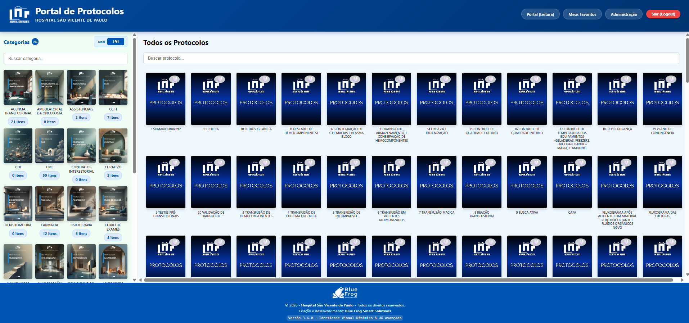
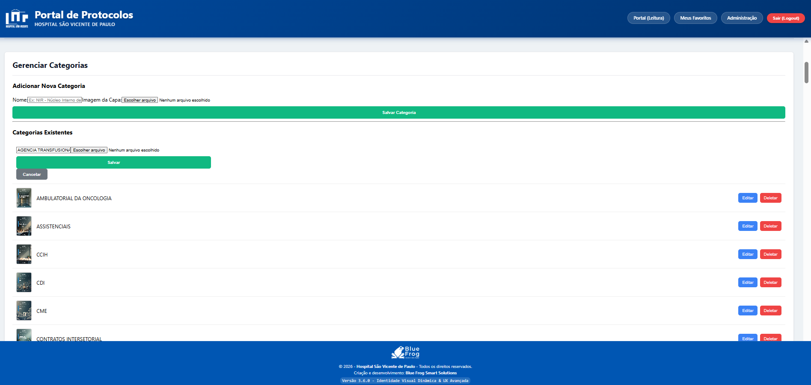
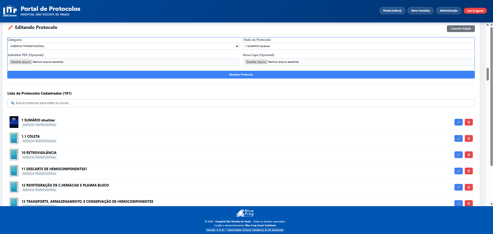

# 🏥 Portal de Protocolos Internos - HSVP

Sistema Full Stack desenvolvido para o **Hospital São Vicente de Paulo**, centralizando o acesso aos Protocolos Operacionais Padrão (POPs) para médicos e colaboradores via Computador e Dispositivos Móveis.

---

## 🚀 Histórico de Versões

### v14.2 (Atual - Acesso Colaborativo & Progressive Disclosure)
* 🤝 **Democratização de Acesso (RBAC):** Libertação das rotas de criação, edição e exclusão de Categorias e Protocolos para o perfil de `colaborador` (Enfermagem), promovendo uma plataforma colaborativa descentralizada.
* 🧠 **UX/UI (Progressive Disclosure):** Ocultação inteligente de campos complexos (como o *upload* de capas) para utilizadores não-administradores, reduzindo a carga cognitiva e prevenindo erros.
* 🤖 **Automação de Backend:** Implementação de sistema de *Fallback* no Node.js. Inserções feitas pela enfermagem (sem ficheiro de imagem) recebem automaticamente as capas padrão (`default_categoria.png` e `default_protocolo.png`), garantindo a padronização visual da plataforma.

### v3.7.0 (Sincronização Persistente de Favoritos & Cores Contextuais)
* ⭐ **Destaque Visual Contextual de UX/UI:** Implementação de cores dinâmicas e intuitivas para os botões de favoritos.
* 🔄 **Normalização e Sincronização de IDs:** Refatoração do motor de estados no React para garantir match exato.

### v3.1.4 (Exclusão Inteligente & Gestão de Integridade)
* 🛡️ **Segurança Relacional:** Restrição preventiva em cascata no motor de exclusão de categorias para evitar ficheiros PDF órfãos.

*(Para versões anteriores, consulte as *releases* do repositório).*

---

## 📸 Galeria do Sistema

### 🏠 Acesso Público e Leitura
| Tela de Login | Tela Inicial (Home) |
| :---: | :---: |
|  |  |

### ⚙️ Painel Administrativo
| Gestão de Categorias | Gestão de Protocolos |
| :---: | :---: |
|  |  |

---

## 📋 Como Rodar o Projeto

### Inicialização Automática
O sistema roda em segundo plano através do **PM2** (Node.js Process Manager).

* **Acesso Oficial na Intranet:** `http://protocolos.saovicente.lan:3001/`
* **Acesso no Servidor Físico (Local):** `http://localhost:3001/`

---

## 🔄 Como Atualizar (Deploy)

Sempre que alterar o código, siga este passo único:

1. Vá até a pasta raiz do projeto.
2. Dê um duplo clique no arquivo: 👉 **`DEPLOY_AUTOMATICO.bat`**
3. Aguarde a janela preta fechar.

---

## 🛡️ Backup e Segurança

**Como fazer o Backup:**
1. Execute o arquivo: 👉 **`BACKUP_TOTAL_V3.bat`**
2. O script salvará os dados e ficheiros em discos de segurança espelhados.

---

## 👤 Autor

**Marcelo Nascimento dos Santos**  
*Desenvolvedor Full Stack & Especialista em IA - Hospital São Vicente de Paulo*  
Fundador da **Blue Frog Smart Solutions** 🐸💙

---
© 2026 Instituto Walfredo Guedes Pereira - Hospital São Vicente de Paulo. Todos os direitos reservados.